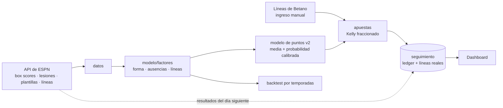

# NBA Predictor

Predicción de los **puntos** de jugadores NBA y gestión de apuestas en papel contra
las líneas de Betano, con una regla central: **no se arriesga dinero real hasta
demostrar ventaja en papel**.

> **Estado:** el modelo de puntos v2 predice mejor que el promedio reciente (error
> medio 4.86 frente a 5.15 puntos) y sus probabilidades están bien calibradas. La
> ventaja contra Betano todavía **no está demostrada**: el backtest solo puede usar
> líneas sintéticas, y la prueba real son las líneas de Betano que el sistema
> registra desde ahora. Detalle en [docs/RECALIBRACION.md](docs/RECALIBRACION.md).

---

## Cómo funciona



**Uso diario**

1. **Hoy:** el dashboard descarga los partidos, el reporte de lesiones, las
   plantillas y las líneas de partido, y predice los puntos de cada jugador de
   rotación.
2. Escribes las líneas de Betano de los jugadores que te interesan. El modelo da
   la probabilidad calibrada de over o under y, si supera el piso, el stake Kelly.
3. **Resultados:** al día siguiente, un botón resuelve los picks con los box
   scores de ESPN. Si el jugador no jugó, el pick queda anulado.
4. **Rendimiento:** ROI, calibración en vivo y el gate papel → dinero real.

---

## Qué tiene en cuenta el modelo

Cada factor se calcula solo con información previa al partido, y una prueba
automática lo verifica.

| Grupo | Ejemplos | En el modelo |
|---|---|:---:|
| Forma del jugador | puntos, minutos y tiros de sus últimos 5, 10 y 20 partidos; promedio de temporada | ✓ |
| Ausencias del equipo | puntos y minutos que dejan libres los compañeros que no juegan, si falta la estrella, rango del jugador entre los disponibles | ✓ |
| Líneas de la casa | spread (riesgo de paliza) y total del partido | ✓ |
| Rival, calendario, motivación | defensa por posición, viajes, huso horario, altitud, racha, playoffs, exequipo | medido; no mejoró |

La selección y sus números están en [docs/RECALIBRACION.md](docs/RECALIBRACION.md).

---

## Resultados

| | Validación 2023-24 y 2024-25 | Holdout 2025-26 |
|---|---:|---:|
| Error medio del modelo | 4.86 pts | 4.81 pts |
| Error del promedio de 10 partidos | 5.15 pts | 5.08 pts |
| Acierto con prob. ≥ 0.70 contra la línea informada | 73.5 % | 75.9 % |

El acierto contra líneas sintéticas **sobreestima** el edge real: esas líneas se
equivocan en casos que Betano no fallaría. Sirve para elegir el umbral, no para
prometer ganancias.

---

## Gate papel → dinero real

| Criterio | Meta |
|---|:---:|
| Muestra | ≥ 300 picks resueltos |
| Acierto | ≥ 54 % (break-even ≈ 53.5 % a cuota 1.87) |
| ROI | ≥ 0 % |
| **Intervalo de confianza** | el límite inferior del IC 95 % (Wilson) supera el break-even |

El último es el que manda: con 100 picks al 54 % el intervalo va de 44 % a 64 % y no
distingue ventaja de suerte.

---

## Instalación

```bash
pip install -e ".[dev]"

# Una vez: descarga el histórico de ESPN (unos minutos, ~60 MB en cache/)
python -m nba_predictor.datos.espn

# Dashboard
streamlit run app/dashboard.py

# Recalibración reproducible (validación; --holdout mide 2025-26)
python scripts/recalibrar.py

# Pruebas
pytest
```

---

## Estructura

```
nba_predictor/
  datos/         ESPN: descarga, tablas jugador-partido y equipo-partido, datos del día
  modelo/        factores, modelo de puntos, configuración congelada, predicción diaria
  apuestas/      Kelly, edge y tamaño de cada apuesta
  seguimiento/   ledger de picks, métricas, gate y diagnóstico
  backtest/      evaluación por temporadas contra líneas sintéticas
app/             dashboard Streamlit
scripts/         recalibración
tests/           pytest
docs/            PRD, TRD, ADR, DATA_SPEC, PLAN, recalibración e históricos
```

---

## Principios

- **Papel antes que dinero.** Nada real sin ventaja demostrada.
- **El backtest manda, pero no promete.** Las decisiones salen de validación; el
  holdout se mide una sola vez.
- **Sin factores de relleno.** Un factor entra solo si mejora la medición.
- **Contabilidad auditable.** El bankroll se deriva del registro de picks.
- **Un mercado bien hecho** (puntos) antes que cinco a medias.

## Documentación

| Documento | Contenido |
|---|---|
| [RECALIBRACION.md](docs/RECALIBRACION.md) | Datos de ESPN, factores, validación y holdout del modelo v2 |
| [PRD.md](docs/PRD.md) · [TRD.md](docs/TRD.md) | Producto y arquitectura técnica |
| [ADR.md](docs/ADR.md) | Decisiones de arquitectura |
| [DATA_SPEC.md](docs/DATA_SPEC.md) | Fuentes de datos y sus trampas |
| [PLAN.md](docs/PLAN.md) | Plan por fases |
| [CALIBRACION.md](docs/CALIBRACION.md) · [baseline.md](docs/baseline.md) · [comparacion.md](docs/comparacion.md) | Mediciones del modelo anterior (histórico) |

---

<sub>Proyecto personal de aprendizaje. Apostar implica riesgo; nada aquí garantiza rentabilidad.</sub>
