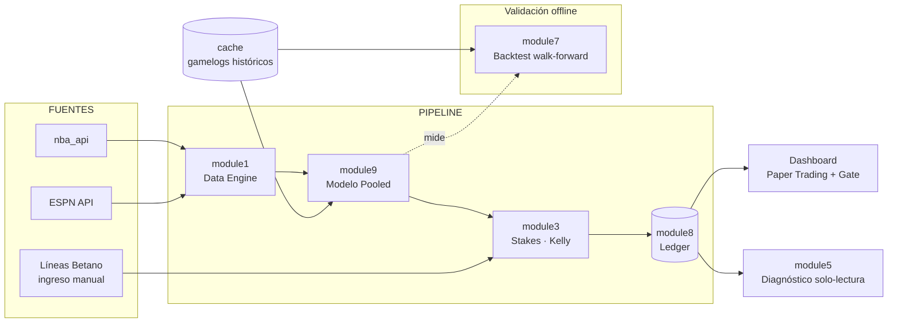

<div align="center">

# 🏀 NBA Predictor Pro

**Sistema de predicción de _player props_ (puntos NBA) con validación honesta antes de arriesgar un peso.**


</div>

---

## 📌 Qué es

Un sistema personal que predice los **puntos (PTS)** de jugadores NBA para un partido y busca _edge_ contra las líneas de la casa (Betano), dimensionando apuestas con **Kelly Criterion**.

Su principio rector: **no se arriesga dinero real hasta demostrar ventaja en papel.** Toda la arquitectura gira en torno a un _backtest_ honesto y una fase de _paper trading_ con un "gate" explícito antes de habilitar dinero real.

> ⚠️ **Estado actual:** el modelo _pooled_ superó a la línea base en el backtest, pero su win rate está **en el break-even** (≈53.5 %) sobre líneas sintéticas — **aún no es rentable**. El sistema está en fase de validación en papel. Ver [`comparacion.md`](comparacion.md).

---

## 🏗️ Arquitectura



**Flujo diario:** cargar datos NBA → el modelo _pooled_ predice PTS → ingresas las líneas de Betano a mano → se calcula el _edge_ y el stake Kelly → los picks quedan en el _ledger_ (modo PAPEL) → marcas el resultado al día siguiente → el dashboard actualiza ROI, calibración y el _gate_.

---

## 🧩 Módulos

| Módulo | Rol |
|--------|-----|
| `module1_data_engine.py` | Descarga stats NBA, injury report (ESPN), partidos del día. Normaliza equipos y filtra DNP. |
| `module9_pooled_model.py` | **Modelo _pooled_**: un XGBoost entrenado con ~30 000 partidos-jugador. Emite media **e incertidumbre** (`pred_sigma`). |
| `module3_stakes_engine.py` | Kelly Criterion, _edge_, sizing. PTS-only, parámetros centralizados en `PARAMS`. |
| `module8_tracking.py` | _Ledger_ append-only. Bankroll **derivado** (no mutable). Métricas y _gate_ papel→real. |
| `module7_backtest_engine.py` | _Backtest_ walk-forward con anti-_leakage_ y línea sintética. La pieza de validación. |
| `module5_error_analysis.py` | Diagnóstico **solo-lectura** (no aplica cambios automáticos). |
| `module2` · `module6` | Código latente: modelos per-jugador / totales / spread y odds automáticas (fuera de v1). |
| `dashboard.py` | Interfaz Streamlit: picks, líneas, historial, **paper trading**, bankroll, diagnóstico. |

Scripts: `descargar_historico.py` (gamelogs a cache) · `correr_baseline.py` · `correr_comparacion.py`.

---

## 📊 Resultados del backtest

Baseline (modelo viejo, per-jugador) **vs.** Pooled (nuevo), sobre los **mismos** 1 240 puntos de test, con la validación final intocable:

| Métrica | Baseline | **Pooled** |
|---------|:--------:|:----------:|
| MAE | 5.94 | **4.98** |
| Sesgo | −0.63 | **+0.18** |
| Win rate | 50.3 % | **53.4 %** |
| ROI proxy | −5.86 % | **−0.13 %** |
| **Edge alto → win rate** | 47.1 % ❌ | **56.9 %** ✅ |

La calibración es lo clave: el modelo viejo ganaba _menos_ en sus picks de mayor confianza (edge anti-predictivo, la raíz de las pérdidas). El _pooled_ **arregla el signo**: los picks de alto edge ganan +12 pp más que los de bajo. Detalle en [`comparacion.md`](comparacion.md) y [`baseline.md`](baseline.md).

---

## 🚦 Gate papel → dinero real

El dashboard no habilita dinero real hasta cumplir **los tres** criterios en modo PAPEL:

| Criterio | Meta |
|----------|:----:|
| Muestra | ≥ 100 picks resueltos |
| Win rate | ≥ 54 % (sobre break-even ≈ 53.5 %) |
| ROI | ≥ 0 % |

Mientras no se cumplan, la regla es simple: **seguir en papel, sin arriesgar dinero.**

---

## ⚙️ Instalación y uso

```bash
# 1. Dependencias
pip install -r requirements.txt

# 2. (una vez) Descargar histórico a cache para el backtest
python descargar_historico.py

# 3. Dashboard
streamlit run dashboard.py
```

Se abre en `http://localhost:8501`. Uso diario: pestaña **Picks del Día** → cargar datos → **Ingresar Líneas** de Betano → calcular picks → registrar resultados en **Historial** → seguir el progreso en **Paper Trading**.

Validación offline:

```bash
python correr_comparacion.py   # baseline vs pooled sobre el mismo test set
```

---

## 🧭 Principios de diseño

- **Papel antes que plata.** Ninguna apuesta real sin edge demostrado.
- **El backtest manda.** Decisiones con evidencia y muestras grandes, no con corazonadas ni rachas cortas.
- **Sin auto-tuning sobre ruido.** El diagnóstico informa; el humano decide.
- **Honestidad estadística.** _Walk-forward_ sin _data leakage_; el bankroll se deriva del ledger (auditable).
- **Un mercado bien hecho** (PTS) antes que cinco a medias.

---

## 📚 Documentación

| Doc | Contenido |
|-----|-----------|
| [PRD.md](PRD.md) | Qué y por qué (producto) |
| [TRD.md](TRD.md) | Arquitectura y contratos técnicos |
| [ADR.md](ADR.md) | 8 decisiones de arquitectura y su porqué |
| [DATA_SPEC.md](DATA_SPEC.md) | Fuentes de datos y sus trampas |
| [PLAN.md](PLAN.md) | Plan de ejecución por fases |
| [baseline.md](baseline.md) · [comparacion.md](comparacion.md) | Resultados medidos |

---

## 🗺️ Roadmap

- [x] **Fase 0** — Higiene: contabilidad derivada, diagnóstico solo-lectura, arreglos de datos
- [x] **Fase 1** — Backtest walk-forward + línea base honesta
- [x] **Fase 2** — Modelo _pooled_ multi-jugador (supera al baseline)
- [x] **Fase 3** — Paper trading + gate papel→real
- [ ] **Fase 4** — Dinero real _(condicionada a superar el gate)_
- [ ] Futuro — reactivar REB/AST/Totales/Spread bajo la misma barra de validación

---

<div align="center">
<sub>Proyecto personal con fines de aprendizaje y experimentación. Las apuestas implican riesgo; nada aquí garantiza rentabilidad.</sub>
</div>
