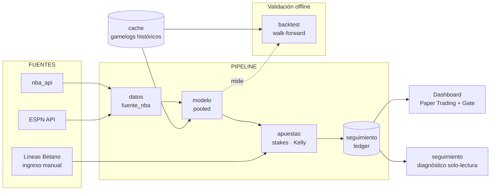

<div align="center">

# 🏀 NBA Predictor Pro

**Sistema de predicción de _player props_ (puntos NBA) con validación honesta antes de arriesgar un peso.**


</div>

---

## 📌 Qué es

Un sistema personal que predice los **puntos (PTS)** de jugadores NBA para un partido y busca _edge_ contra las líneas de la casa (Betano), dimensionando apuestas con **Kelly Criterion**.

Su principio rector: **no se arriesga dinero real hasta demostrar ventaja en papel.** Toda la arquitectura gira en torno a un _backtest_ honesto y una fase de _paper trading_ con un "gate" explícito antes de habilitar dinero real.

> ⚠️ **Estado actual:** el modelo _pooled_ superó a la línea base en el backtest, pero su win rate está **en el break-even** (≈53.5 %) sobre líneas sintéticas — **aún no es rentable**. El sistema está en fase de validación en papel. Ver [`comparacion.md`](docs/comparacion.md).

---

## 🏗️ Arquitectura



**Flujo diario:** cargar datos NBA → el modelo _pooled_ predice PTS → ingresas las líneas de Betano a mano → se calcula el _edge_ y el stake Kelly → los picks quedan en el _ledger_ (modo PAPEL) → marcas el resultado al día siguiente → el dashboard actualiza ROI, calibración y el _gate_.

---

## 🧩 Estructura

```
nba_predictor/          paquete principal
  datos/                descarga de stats, lesiones y partidos del día
  modelo/               features por jugador, modelo pooled y baseline
  apuestas/             Kelly, edge y tamaño de cada apuesta (solo PTS)
  seguimiento/          ledger de picks, métricas, gate y diagnóstico
  backtest/             backtest walk-forward sin leakage
app/dashboard.py        interfaz Streamlit
scripts/                descarga histórica, baseline, comparación y diagnósticos
tests/                  pruebas (pytest)
docs/                   PRD, TRD, ADR, DATA_SPEC, PLAN y resultados medidos
```

| Pieza | Rol |
|-------|-----|
| `datos/fuente_nba.py` | Descarga stats NBA, reporte de lesiones (ESPN) y partidos del día. Normaliza equipos y filtra DNP. |
| `modelo/pooled.py` | **Modelo _pooled_**: un XGBoost entrenado con ~30 000 partidos-jugador. Emite media **e incertidumbre** (`pred_sigma`). |
| `modelo/features.py` | Features de cada partido construidas solo con partidos anteriores. |
| `modelo/baseline.py` | Modelo por jugador original; solo sirve de referencia en el backtest. |
| `apuestas/stakes.py` | Kelly Criterion, _edge_ y tamaño de apuesta. Parámetros centralizados en `PARAMS`. |
| `seguimiento/ledger.py` | _Ledger_ append-only. Bankroll **derivado** (no mutable). Métricas y _gate_ papel→real. |
| `seguimiento/diagnostico.py` | Diagnóstico **solo-lectura** (no aplica cambios automáticos). |
| `backtest/walk_forward.py` | _Backtest_ walk-forward con anti-_leakage_ y línea sintética. La pieza de validación. |

---

## 📊 Resultados del backtest

Baseline (modelo viejo, per-jugador) **vs.** Pooled (nuevo), sobre los **mismos** 1 240 puntos de test, con la validación final intocable:

| Métrica | Baseline | **Pooled** |
|---------|:--------:|:----------:|
| MAE | 5.94 | **4.98** |
| Sesgo | −0.63 | **+0.18** |
| Win rate | 50.3 % | **53.4 %** |
| ROI proxy | −5.86 % | **−0.13 %** |
| **Edge alto → win rate** | 47.1 % ❌ | **56.9 %** ✅ |

La calibración es lo clave: el modelo viejo ganaba _menos_ en sus picks de mayor confianza (edge anti-predictivo, la raíz de las pérdidas). El _pooled_ **arregla el signo**: los picks de alto edge ganan +12 pp más que los de bajo. Detalle en [`comparacion.md`](docs/comparacion.md) y [`baseline.md`](docs/baseline.md).

---

## 🚦 Gate papel → dinero real

El dashboard no habilita dinero real hasta que, en modo PAPEL, se cumpla todo esto:

| Criterio | Meta |
|----------|:----:|
| Muestra | ≥ 300 picks resueltos |
| Win rate | ≥ 54 % (sobre el break-even ≈ 53.5 %) |
| ROI | ≥ 0 % |
| **Intervalo de confianza** | El límite inferior del IC 95 % (Wilson) supera el break-even |

El último es el que manda: con 100 picks al 54 % el intervalo va de 44 % a 64 %, así que ese resultado no distingue ventaja de suerte. Mientras no se cumpla, la regla es simple: **seguir en papel, sin arriesgar dinero.**

---

## ⚙️ Instalación y uso

```bash
# 1. Instalar el paquete y sus dependencias
pip install -e ".[dev]"

# 2. (una vez) Descargar histórico a cache para el backtest
python scripts/descargar_historico.py

# 3. Dashboard
streamlit run app/dashboard.py

# Pruebas
pytest
```

Se abre en `http://localhost:8501`. Uso diario: pestaña **Picks del Día** → cargar datos → **Ingresar Líneas** de Betano → calcular picks → registrar resultados en **Historial** → seguir el progreso en **Paper Trading**.

Validación offline:

```bash
python scripts/correr_comparacion.py   # baseline vs pooled sobre el mismo test set
```

---

## 🧭 Principios de diseño

- **Papel antes que plata.** Ninguna apuesta real sin edge demostrado.
- **El backtest manda.** Decisiones con evidencia y muestras grandes, no con corazonadas ni rachas cortas.
- **Sin auto-tuning sobre ruido.** El diagnóstico informa; el humano decide.
- **Honestidad estadística.** _Walk-forward_ sin _data leakage_; el bankroll se deriva del ledger (auditable).
- **Un mercado bien hecho** (PTS) antes que cinco a medias.

---

## 📚 Documentación

| Doc | Contenido |
|-----|-----------|
| [PRD.md](docs/PRD.md) | Qué y por qué (producto) |
| [TRD.md](docs/TRD.md) | Arquitectura y contratos técnicos |
| [ADR.md](docs/ADR.md) | 8 decisiones de arquitectura y su porqué |
| [DATA_SPEC.md](docs/DATA_SPEC.md) | Fuentes de datos y sus trampas |
| [PLAN.md](docs/PLAN.md) | Plan de ejecución por fases |
| [baseline.md](docs/baseline.md) · [comparacion.md](docs/comparacion.md) · [CALIBRACION.md](docs/CALIBRACION.md) | Resultados medidos |

---

## 🗺️ Roadmap

- [x] **Fase 0** — Higiene: contabilidad derivada, diagnóstico solo-lectura, arreglos de datos
- [x] **Fase 1** — Backtest walk-forward + línea base honesta
- [x] **Fase 2** — Modelo _pooled_ multi-jugador (supera al baseline)
- [x] **Fase 3** — Paper trading + gate papel→real
- [ ] **Fase 4** — Dinero real _(condicionada a superar el gate)_
- [ ] Futuro — reactivar REB/AST/Totales/Spread bajo la misma barra de validación

---

<div align="center">
<sub>Proyecto personal con fines de aprendizaje y experimentación. Las apuestas implican riesgo; nada aquí garantiza rentabilidad.</sub>
</div>
